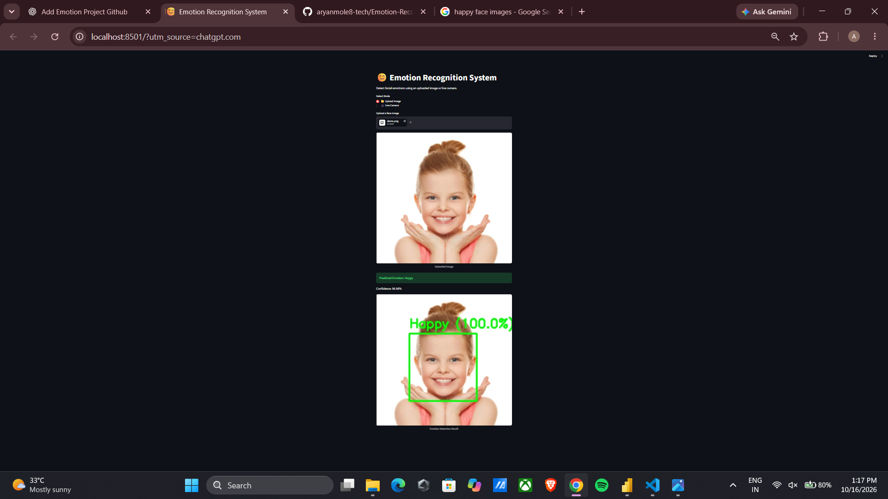
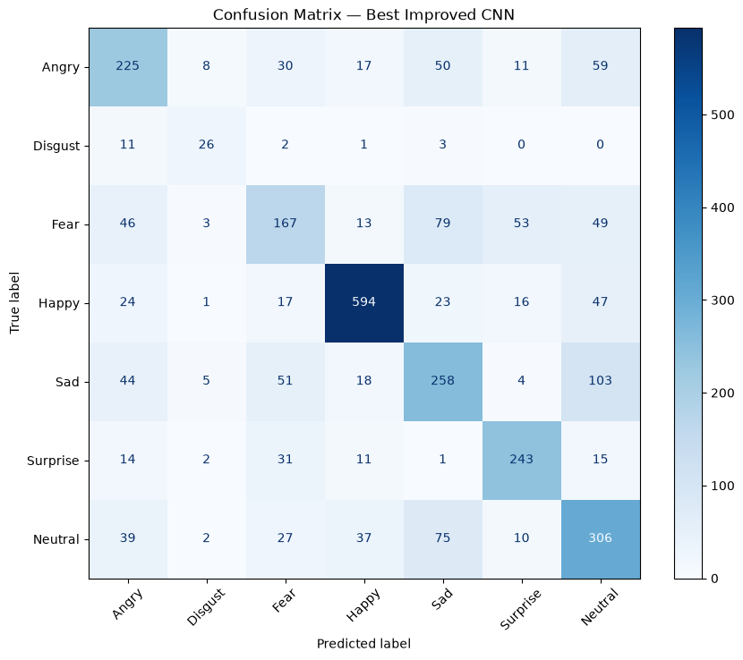
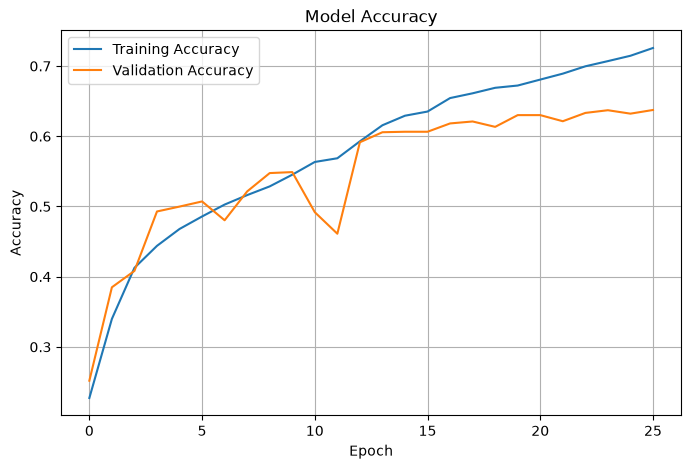
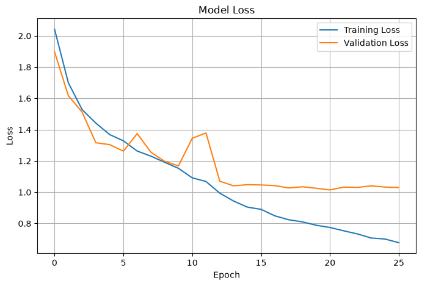

# Facial Emotion Recognition Using CNN

A deep learning project that classifies facial expressions using a Convolutional Neural Network (CNN), OpenCV, TensorFlow, and Streamlit.

## Project Overview

This system detects faces and classifies facial expressions into seven categories:

- Angry
- Disgust
- Fear
- Happy
- Sad
- Surprise
- Neutral

The project includes CNN model training, performance evaluation, image-based inference, and real-time webcam prediction.

## Key Features

- Facial expression classification using CNN
- Face detection using OpenCV Haar Cascades
- Image upload and emotion prediction
- Real-time webcam emotion detection
- Confidence scores for predicted classes
- Training history and model evaluation
- Interactive Streamlit interface

## Technology Stack

- Python
- TensorFlow / Keras
- OpenCV
- NumPy
- Pandas
- Matplotlib
- Scikit-learn
- Streamlit
- Streamlit-WebRTC

## Dataset

FER-2013 is a facial expression recognition dataset containing 48x48 grayscale face images.

The dataset includes seven emotion categories.

The training CSV is excluded from this repository due to its size and redistribution considerations.

To reproduce training, obtain a suitable FER-2013 dataset copy and place it at:

    train.csv

The notebook expects columns named `emotion` and `pixels`.

## Model Development

1. Load and explore the dataset.
2. Convert pixel strings into 48x48 grayscale images.
3. Normalize image values to the range 0-1.
4. Split the dataset into training, validation, and testing sets.
5. Train a baseline CNN.
6. Evaluate the baseline model.
7. Build an improved CNN with training controls and class weighting.
8. Evaluate the improved model.
9. Save the trained model for inference.

## Model Performance

| Model | Test Accuracy |
|-------|---------------|
| Baseline CNN | Approximately 57.02% |
| Improved CNN | Approximately 61.93% |

These results were recorded during project development.

## Project Structure

    Emotion_Recognition_CNN/
    |
    |-- app.py
    |-- emotion_cnn.ipynb
    |-- best_emotion_model.keras
    |-- final_emotion_recognition_model.keras
    |-- requirements.txt
    |-- README.md
    |-- .gitignore

## Installation

Clone the repository:

    git clone https://github.com/YOUR_USERNAME/Emotion-Recognition-Using-CNN.git

Enter the project folder:

    cd Emotion-Recognition-Using-CNN

Install dependencies:

    pip install -r requirements.txt

Run the application:

    streamlit run app.py

## How It Works

1. The user uploads an image or enables the webcam.
2. OpenCV identifies faces using a Haar Cascade detector.
3. Detected faces are converted to grayscale.
4. Each face is resized to 48x48 pixels and normalized.
5. The trained CNN predicts the facial expression category.
6. The application displays the predicted label and confidence score.

## Limitations

- Model accuracy varies across facial expressions.
- Lighting, camera quality, and face orientation can affect predictions.
- Facial expression classification does not reliably determine a person's actual emotional state.
- Real-time camera functionality requires browser camera permission.

## Future Improvements

- Improve classification accuracy with transfer learning.
- Evaluate generalization on additional datasets.
- Improve detection under challenging lighting conditions.
- Optimize real-time prediction performance.

## Author

Aryan S. Mole

B.Tech - Computer Science and Engineering (Data Science)

## Project Purpose

Developed as a practical deep learning and computer vision project demonstrating model training, evaluation, and application deployment.

---

## Application Screenshots

### Streamlit Application Home Page

### Image-Based Emotion Prediction

The system detects a face and displays the predicted facial expression with a confidence score.

### Real-Time Webcam Emotion Detection

The application supports webcam-based facial expression predictions using OpenCV and Streamlit-WebRTC.

---

## Model Evaluation Visualizations

### Confusion Matrix

The confusion matrix visualizes classification results across the seven facial expression categories.

### Training and Validation Accuracy

### Training and Validation Loss

